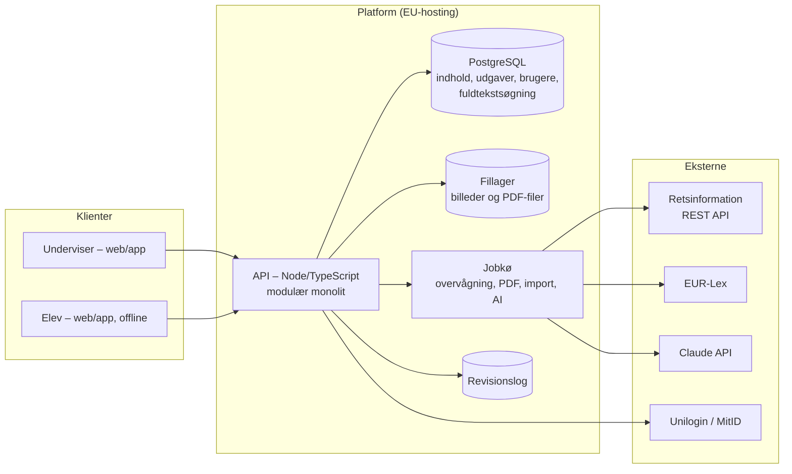

# Intelligent maritim undervisningsportal – konceptanalyse og udviklingsplan

**Marstal Navigationsskole · november 2026 · version 1**

> Prototypen, der hører til dette dokument, ligger i samme repository og kan afprøves direkte i browseren (se afsnit 14).

---

## 1. Resumé

Underviseren bruger i dag mange timer på at rette **den samme oplysning flere steder** i PDF-dokumenter – fx når en regel om hviletid ændres, eller når en formel skal rettes i flere kompendier. Problemet er ikke, at der mangler en læringsplatform. Problemet er, at **materialet er bygget som færdige dokumenter i stedet for som data**.

Vores anbefaling er derfor at bygge portalen som et **forfattersystem med én kilde til sandheden**:

| I dag (PDF) | I portalen |
|---|---|
| Et tal står i 12 dokumenter | Tallet findes ét sted (“central oplysning”) og vises alle 12 steder |
| En formel er kopieret ind i flere kompendier | Formlen ligger i formelbiblioteket og indsættes som henvisning |
| Lovændring = læs alt igennem manuelt | Systemet finder de berørte steder og foreslår rettelser |
| Ny PDF udsendes, eleverne ved ikke hvad der er ændret | “Søret – version 2.4 · 7 ændringer · Se ændringer” |
| Gamle versioner overskrives | Hver udgave bevares og kan sammenlignes |

Målet fra oplægget – **“én ændring og én godkendelse”** – er realistisk for alt, der er struktureret som centrale oplysninger, formler og retskilder. Fritekst, der nævner gamle værdier direkte, kræver stadig et kig fra underviseren, men systemet finder stederne og laver forslaget, og godkendelsen erstatter samtidig teksten med en henvisning, så næste ændring sker automatisk.

---

## 2. Analyse af behovet

**Hvem er brugerne?**
- *Underviseren* (primær): fagekspert i søret, navigation og skibsteknik; ikke udvikler. Skal kunne arbejde videre i eksisterende materiale uden at starte forfra.
- *Eleven*: læser på mobil, tablet og pc – ofte under sejlads med svingende net. Har brug for at vide, hvad der er ændret, og for at regne selv.
- *Administrator* (skolen): brugere, hold, adgang, persondata og senere salg.

**Hvor går tiden i dag?** (skøn, skal valideres med underviseren)
1. Finde alle steder, hvor en regel/værdi er nævnt.
2. Rette den samme ting flere gange – med risiko for at glemme ét sted.
3. Genudgive PDF'er og forklare eleverne, hvad der er nyt.
4. Vedligeholde formler og regneeksempler, der er kopieret rundt.
5. Lave nye opgaver med facit.

**Konklusion:** De største gevinster kommer fra *struktur* (punkt 1, 2, 4) og *udgivelsesflow* (punkt 3). AI giver ekstra gevinst ved at foreslå tekst og lave opgaver (punkt 5), men er ikke fundamentet.

---

## 3. Kerneprincip: indhold som data

Alt materiale består af fire slags byggesten:

| Byggesten | Eksempel | Bruges i teksten som |
|---|---|---|
| **Tekst** (markdown) | Afsnit, tabeller, billeder, citater | almindelig tekst |
| **Central oplysning** | “Minimum hviletid pr. 7 døgn = 77 timer” | `{{fakta:hvile-7d}}` |
| **Formel** | `GM = KM − KG` med variabler, enheder og testeksempel | `{{formel:gm}}` → interaktiv beregner |
| **Retskilde** | STCW Kode A-VIII/1 med ordlyd og gyldighedsdato | `{{kilde:stcw-a-viii-1}}` |

Henvisningerne er det, der gør automatisk opdatering mulig: Systemet ved præcis, hvilke kapitler der bruger hvad.

---

## 4. Gennemgang af de ni områder – vurdering og forbedringer

### 4.1 Intelligent redigeringssystem
- **Kan løses fuldt ud** med strukturen ovenfor. Prototypen har editor med værktøjslinje, live forhåndsvisning, indsættelse af oplysninger/formler/kilder, underkapitler og versionshistorik med sammenligning og gendannelse.
- **Forbedring:** Genbrugelige *afsnit* (“byggeklodser”), fx et standardafsnit om ISM-koden, der indgår i flere bøger og kun vedligeholdes ét sted.
- **Forbedring:** En “berørt-af”-oversigt *før* man ændrer noget: “Denne oplysning bruges i 14 kapitler i 3 bøger”.

### 4.2 Søret og lovændringer
- **Delvist automatiserbart.** Danske regler kan overvåges automatisk via Retsinformation. IMO-regler kræver manuel registrering (se afsnit 11).
- **Vigtig skelnen:** Systemet *finder* og *foreslår* – det *ændrer aldrig* juridisk indhold selv. Prototypen kræver eksplicit godkendelse pr. forslag og logger kilde, dato, beslutning og om AI har hjulpet.
- **Forbedring:** Planlagt udgivelse, så en ny version kan gå live på den dato, reglen træder i kraft.

### 4.3 Formelsystem
- **Kan løses fuldt ud** for algebraiske formler. Prototypen har en sikker formelmotor (ingen kodekørsel), mellemregninger, enheder, advarsler (fx “GM under IS-kodens 0,15 m”), kontroleksempler og opgavegenerator.
- **Forbedring:** Ægte enhedskontrol (dimensionsanalyse: m · t ≠ m²), formler i flere trin (fx KG → GM → krængning), tabelopslag (hydrostatiske tabeller, deviationstabeller) og grafer (GZ-kurve).

### 4.4 Elevportal
- Alle ønskede funktioner er med i prototypen: fag og bøger, mobilvenlig læsning, besked ved ny udgave, “Se ændringer”, søgning, bogmærker, personlige noter, beregnere og PDF-download, når underviseren tillader det.
- **Forbedring:** Offline-læsning (vigtigt til søs), “Jeg forstår ikke dette afsnit”-knap, så underviseren kan se, hvor eleverne går i stå, og en ordliste med maritime fagudtryk (dansk/engelsk/SMCP).

### 4.5 AI-assistent
- Seks af de syv eksempelkommandoer fra oplægget findes i prototypen. Fire af dem kører **uden** AI, fordi de bygger på strukturen: find, kontrollér formler, vis ændringer og lav regneopgaver. Det er hurtigere, gratis og helt forudsigeligt.
- Sprogopgaver går til Claude: forklar enklere, foreslå formulering ud fra ny bestemmelse og frie spørgsmål. Svar vises altid som forslag med markering af forskelle.

### 4.6 Udgivelses- og versionssystem
- Prototypen gør præcis de fem ting fra oplægget: gemmer udgaven, registrerer ændringer, opdaterer elevportalen, giver eleverne besked og bevarer historikken. Udgivelse kan ske for hele bogen eller ét kapitel.
- **Forbedring:** Kollegial gennemlæsning før udgivelse (“send til kollega”) og låste eksamensudgaver.

### 4.7 Indtjening
- Datamodellen har produkter (bog, fagpakke, abonnement, licens, eksamenspakke), men betaling er bevidst ikke koblet på i version 1. Se afsnit 13.

### 4.8 Administration og videreudvikling
- Tre roller (administrator, underviser, elev). Undervisere kan selv oprette fag, elever og elevgrupper. Backend er opdelt i moduler, så nye funktioner kan tilføjes som nye moduler.

### 4.9 Design
- Underviserens dashboard viser de seks ønskede felter: materialer, lovændringer, materiale under redigering, seneste udgivelser, elever og adgang samt formelbibliotek. Bundmenu på mobil, installérbar som app.

---

## 5. Automatisering og AI – muligheder og grænser

| Opgave | Hvordan | AI nødvendig? | Underviserens rolle |
|---|---|---|---|
| Opdatér en værdi alle steder | Central oplysning | Nej | Én godkendelse |
| Find berørte kapitler ved lovændring | Henvisninger + tekstsøgning | Nej | Gennemse listen |
| Foreslå ny formulering af afsnit | Claude med gammel/ny bestemmelse | Ja | Ret og godkend |
| Erstat hårdkodede værdier med henvisninger | Regel i forslaget | Nej | Godkend |
| Kontrollér formler | Testeksempler, variabler, enheder | Nej | Ret fejl |
| Lav regneopgaver med facit | Formelbibliotek + tilfældige værdier | Nej | Udvælg |
| Forklar enklere / niveautilpas | Claude | Ja | Vælg og ret |
| Genkend struktur ved import | Overskriftsregler | Delvist | Gennemse |
| Genkend formler og henvisninger ved import | Mønstre + Claude | Ja (v2) | Bekræft |
| Opsummér en ny bekendtgørelse | Claude med dokumentet | Ja (v2) | Læs |

**Principper for AI:**
1. AI ændrer aldrig indhold uden godkendelse – især ikke juridisk indhold.
2. AI får altid kilden med (gammel og ny ordlyd) og bedes om ikke at opfinde regler eller tal.
3. Alle AI-assisterede ændringer markeres i dokumentationsloggen.
4. Strukturerede funktioner foretrækkes frem for AI, hvor de kan løse opgaven.

Teknisk bruges Claude via Anthropics officielle SDK (model `claude-opus-5-5`) med strukturerede svar (JSON-skema) og automatisk fallback, hvis en forespørgsel afvises. AI er valgfrit: uden nøgle virker alt andet.

---

## 6. Yderligere forslag, der sparer underviseren tid

1. **Byggeklodser på tværs af bøger** – fælles afsnit vedligeholdes ét sted.
2. **Eksamensopgavebank** med automatisk variation af tal (så hver elev får sit eget sæt) og facit med mellemregninger.
3. **Låste eksamensudgaver** – til eksamen fryses en bestemt version, så alle læser det samme.
4. **Planlagt udgivelse** på ikrafttrædelsesdatoen.
5. **Elevfeedback på afsnit** (“uklart”, “fejl?”) direkte til underviseren – hurtig fejlretning.
6. **Statistik:** hvilke kapitler læses mindst, og hvad søger eleverne efter uden at finde det.
7. **Kollega-review** før udgivelse og deling af bøger mellem undervisere (også på tværs af skoler – grundlag for licensmodellen).
8. **Ordliste og SMCP-termer** genereret ud fra materialet.
9. **Skabeloner** til nye kapitler (læringsmål, teori, eksempel, opgaver).
10. **Import-assistent**, der foreslår centrale oplysninger ud fra tal, der optræder mange gange.

---

## 7. Teknisk systemarkitektur

### 7.1 Prototypen (i dette repository)
- **Node.js** uden framework; **modulær backend** (`modules/content`, `books`, `legal`, `assistant`, `admin`) oven på en lille kerne (`api.js`) med adgangskontrol og sessioner.
- **Delte biblioteker** (`shared/formula.js`, `shared/diff.js`) bruges af både server og browser.
- **Database:** JSON-fil (prototype). **Frontend:** ren JavaScript, installérbar som app (PWA).
- **Demo-udgave:** samme kode samlet i én HTML-fil, der kører helt i browseren.

### 7.2 Anbefalet produktionsarkitektur



| Lag | Valg | Begrundelse |
|---|---|---|
| Frontend | Webapp/PWA (evt. React senere) | Én kodebase til mobil, tablet og pc; offline-cache |
| Backend | Node.js/TypeScript, modulær monolit | Én udvikler kan drive den; moduler kan udskilles senere |
| Database | PostgreSQL med JSONB og dansk fuldtekstsøgning | Robust, versionering via tabeller, søgning indbygget |
| Filer | S3-kompatibelt lager i EU | Billeder, importerede og eksporterede PDF'er |
| Baggrundsjob | Jobkø (fx pg-boss) | Overvågning af retskilder, PDF-generering, AI |
| Login | Unilogin (elever) og skolens konti; MitID Erhverv for administratorer | Elever og undervisere har allerede disse |
| Hosting | EU-region, backup, kryptering | GDPR |

### 7.3 Datamodel (kerne)

| Tabel | Indhold |
|---|---|
| `subjects`, `groups`, `users` | Fag, hold og brugere med roller |
| `books`, `chapters` | Arbejdskopi: kapitler med underkapitler, status “klar”, revisioner |
| `editions` | Låst øjebliksbillede pr. udgivelse: kapitler + de oplysninger, formler og kilder, de brugte |
| `facts`, `formulas`, `sources/provisions` | Bibliotekerne med historik |
| `legal_changes`, `proposals`, `change_log` | Lovændringer, forslag og dokumentation |
| `notifications`, `bookmarks`, `notes`, `reads` | Elevens data |
| `products`, `entitlements` | Forberedt til salg og adgangsstyring |

---

## 8. PDF-import

```
Upload (PDF / Word / tekst)
  → tekstudtræk  (PDF: pdf.js · Word: mammoth · scannet PDF: OCR – version 2)
  → struktur     (overskrifter, nummerering “3.2”, “Kapitel 4”, tabeller)
  → genkendelse  (paragraffer, regelnumre, konventionsnavne, linjer der ligner formler)
  → gennemsyn    (underviseren retter titler, niveauer og fravælger)
  → kladder      (intet er synligt for elever før udgivelse)
  → efterbehandling: kobl til retskilder, formelbibliotek og centrale oplysninger
```

**Prototypen** kan importere PDF, Word (.docx) og tekst, deler i kapitler og underkapitler og viser, hvor mange henvisninger og mulige formler der er fundet.

**Begrænsninger:** PDF'er gemmer ikke struktur, så tabeller og formler sat som billeder kræver efterbehandling. Scannede PDF'er kræver tekstgenkendelse (OCR). **Version 2:** Claude hjælper med at genkende formler (→ formelbibliotek), gentagne tal (→ centrale oplysninger) og regelhenvisninger (→ retskilder), som underviseren bekræfter.

---

## 9. Formelstyring

- **Ét sted:** Hver formel har navn, emne, udtryk, resultat (symbol, enhed, decimaler), variabler (beskrivelse, enhed, eksempelværdi, rimelige grænser), forklaring, advarselsregler og et **kontroleksempel med kendt facit**.
- **Sikker motor:** Egen parser – ingen kørsel af kode. Vinkelfunktioner i grader. Danske decimaltal (komma).
- **Elevvisning:** Beregner med indtastning, mellemregninger (formel → indsatte værdier → delresultat → resultat), enheder og advarsler (fx negativt GM).
- **Kontrol:** Ved hver gemning tjekkes variabler, enheder og testeksempel. Assistenten finder også henvisninger til formler, der ikke findes, og symboler med forskellige enheder.
- **Ændring:** Retter man formlen, slår det igennem i alle kapitler ved næste udgivelse. Tidligere versioner af formlen gemmes.
- **Version 2:** Dimensionsanalyse, formler i kæde, tabelopslag og grafer.

---

## 10. Versionskontrol

1. **Arbejdskopi:** Underviseren redigerer frit. Hver gemning gemmer den forrige version af kapitlet (revision), som kan sammenlignes og gendannes.
2. **Klar til udgivelse:** Kapitler markeres klar. Ændrede centrale oplysninger, formler og retskilder kommer automatisk med, fordi de per definition er godkendt ét sted.
3. **Udgave:** “Udgiv ny version” laver et låst øjebliksbillede (major.minor, fx 2.3 → 2.4 eller 3.0) af kapitlerne *og* de værdier, de henviser til. Eleverne læser altid en udgave – aldrig arbejdskopien.
4. **Ændringsliste:** Udgaven sammenlignes linje for linje og ord for ord med den forrige. Eleverne får besked og kan se præcis hvad der er ændret. Tidligere udgaver kan læses.
5. **Kapitel-udgivelse:** Ét kapitel kan udgives alene (giver en ny mindre version).

---

## 11. Integration med officielle retskilder

| Kilde | Adgang | Hvad kan automatiseres |
|---|---|---|
| **Retsinformation** (danske love og bekendtgørelser, herunder Søfartsstyrelsens) | Åbent REST-API fra Civilstyrelsen til dokumenter ændret i et tidsrum (vejledning v1.3, sept. 2023). Højst ét kald pr. 10 sekunder, åbent kl. 03–23.45. Dokumenter hentes som XML via ELI-adresser. Siden april 2024 findes også en datasynkroniseringstjeneste. | Daglig kontrol af overvågede love/bekendtgørelser; hent ny konsolideret tekst; sammenlign paragraf for paragraf |
| **Søfartsstyrelsen** | Regler udstedes som bekendtgørelser på Retsinformation. Vejledninger og nyheder findes på Søfartsstyrelsens hjemmeside. | Via Retsinformation; nyheder registreres manuelt eller via nyhedsbrev |
| **EU (EUR-Lex)** | Publikationskontorets webtjenester og åbne data | Overvågning af relevante forordninger/direktiver (version 2) |
| **IMO** (SOLAS, STCW, COLREG, MARPOL, IS-koden) | Intet åbent API; tekster er ophavsretligt beskyttede. SOLAS-ændringer følger ifølge branchekilder en fast fireårig cyklus (næste ikrafttræden 1. januar 2028). | Manuel registrering ud fra IMO-resolutioner, Søfartsstyrelsens meddelelser og nyhedsbreve; påmindelser omkring faste ikrafttrædelsesdatoer |

**Bemærkninger:**
- Danske love og bekendtgørelser er ikke omfattet af ophavsret (ophavsretslovens § 9) og kan citeres frit. IMO-tekster bør kun gengives kort og med kildehenvisning.
- Prototypen har en adapter til Retsinformation, der aktiveres med en miljøvariabel. Felterne skal efterprøves mod Civilstyrelsens aktuelle vejledning, før den sættes i drift.
- Matchning sker på tre niveauer: (1) kapitler, der citerer bestemmelsen, (2) centrale oplysninger knyttet til den, (3) fritekst med de gamle værdier.

---

## 12. Udviklingsplan

Estimaterne forudsætter 1–2 udviklere og løbende test med underviseren. De er vejledende.

| Fase | Indhold | Varighed (skøn) |
|---|---|---|
| **0. Prototype** ✅ | Hele arbejdsgangen fra redigering til elevvisning (denne leverance) | – |
| **1. MVP (pilot)** | PostgreSQL, rigtigt login, hosting i EU, import af underviserens egne PDF'er, Retsinformation i drift, PDF-eksport i høj kvalitet, backup og revisionslog. Pilot med én underviser og ét hold. | 3–4 måneder |
| **2. Version 2** | Offline-læsning, AI-assisteret import (formler/oplysninger/henvisninger), planlagt udgivelse, kollega-review, enhedskontrol i formler, tabelopslag og grafer, elevfeedback på afsnit, statistik | 3–4 måneder |
| **3. Version 3 – skalering** | Flere skoler (multi-tenant), deling af bøger mellem undervisere, eksamensudgaver og opgavebank, betaling og adgangspakker, engelsk version | 4–6 måneder |

**MVP-succeskriterier:**
- En lovændring kan føres igennem fra opdagelse til ny udgave på under 15 minutter.
- Mindst 80 % af underviserens tal og formler i ét fag ligger som centrale oplysninger/formler.
- Eleverne bruger “Se ændringer” ved hver ny udgave.

---

## 13. Forretningsmodel (til senere skalering)

**Første prioritet er at spare underviseren tid** – betaling skal ikke komplicere version 1.

| Model | Kunde | Hvordan |
|---|---|---|
| **Skolelicens** | Maritime uddannelsesinstitutioner | Årlig pris pr. aktiv elev eller fast pris pr. skole; alle bøger og beregnere |
| **Forfatterabonnement** | Andre undervisere | Månedlig pris for forfatterværktøjet (redigering, formler, lovovervågning, udgivelse) |
| **Digitale bøger** | Elever, selvstuderende, søfarende | Køb pr. bog med opdateringer i 12 måneder |
| **Fag- og eksamenspakker** | Elever | Interaktive opgaver, formelsamling og eksamensforberedelse |
| **Efteruddannelse** | Rederier og kursussteder | Licens til opdateret regelmateriale (fx STCW-genopfriskning) |

**Forudsætninger, der skal afklares tidligt:**
- **Ophavsret:** Materiale lavet som led i en ansættelse kan tilhøre skolen. Aftal hvem der ejer indholdet, og hvordan en eventuel indtægt deles, *før* der sælges noget.
- **Ansvar:** Undervisningsmateriale i søret er ikke juridisk rådgivning – vis altid kilde og gyldighedsdato.
- Priser bør fastsættes efter en pilot. Tallene i prototypens produktliste er pladsholdere.

---

## 14. Prototypen – sådan afprøves hele arbejdsgangen

**Brugere:** underviser `lars` / `laerer123` · elev `anna` / `elev123` · administrator `admin` / `admin123`

1. **Log ind som underviser** (vælg “Lærerportal”). Overblikket viser én foreslået lovændring.
2. **Gennemgå lovændringen** (den er *fiktiv* og tydeligt mærket). Se forskellen i bestemmelsen og de seks forslag:
   - 2 centrale oplysninger (10 → 11 timer, 77 → 80 timer) – én godkendelse opdaterer alle steder.
   - Retskildens nye ordlyd.
   - 2 tekstafsnit, der nævner de gamle tal direkte – forslaget erstatter dem med henvisninger. Prøv “Lad AI foreslå formulering”.
   - 1 kapitel, der bør gennemlæses.
3. **Godkend** forslagene. Alle beslutninger logges med kilde og dato (Mere → Dokumentation).
4. **Udgiv ny version** af Søret: se præcis hvad eleverne får at se, vælg version 2.4, og udgiv.
5. **Log ind som elev:** Forsiden viser “Søret – version 2.4 er udgivet · Se ændringer”. Kapitlet om hviletid viser nu 11 og 80 timer.
6. **Prøv også:** Formelbiblioteket (ret en formel og se kontrollen), beregnerne i *Stabilitet og trim*, assistentens “Lav regneopgaver”, import af et dokument, søgning, bogmærker og noter.

---

## 15. Risici og tiltag

| Risiko | Tiltag |
|---|---|
| Fejl i juridisk indhold | Godkendelse af hver ændring, kildehenvisninger, gyldighedsdatoer, dokumentationslog |
| AI foreslår forkert tekst | AI-forslag vises som forskel, skal godkendes, markeres i loggen; strukturerede funktioner frem for AI |
| Retskilders API ændres | Adapter-lag, overvågning af fejl, manuel registrering som reserve |
| Persondata (GDPR) | Hosting i EU, databehandleraftaler (også med AI-leverandør), sletning af brugerens data, indsigt i egne data (findes i prototypen) |
| Underviseren tager ikke systemet i brug | Import af eksisterende materiale, pilot med tæt opfølgning, fokus på det der sparer mest tid |
| Uklart ejerskab af indhold | Skriftlig aftale med skolen før kommercialisering |
